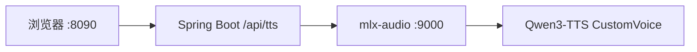

# 千问文本转语音演示

浏览器里输入文字，选择音色和语气，由本机模型合成 WAV 并直接播放。密钥和模型都留在本机，页面不访问云端。

当前模型是 [Qwen3-TTS-12Hz-1.7B-CustomVoice-8bit](https://huggingface.co/mlx-community/Qwen3-TTS-12Hz-1.7B-CustomVoice-8bit)。它只使用模型里写好的 9 个说话人。东北话、粤语、闽南语、台语、上海话不在这套音色里。

## 先点 Star

这个仓库公开出来，是为了让同样在接千问语音的人少走弯路。

**请先点右上角的 Star，再克隆。** 觉得用不上、也不打算标星的，请自觉不要 clone。谢谢。

标星之后，更新和问题修复会出现在你的 GitHub 动态里，不用反复回来找仓库。

## 它做什么

- 一个中文页面：文本、语气、音色，点一下就能听。
- Spring Boot 把请求转到本机的 mlx-audio，接口兼容 OpenAI 的 `POST /v1/audio/speech`。
- 语气只改变朗读方式，不改写原文。预设有专业、幽默、儿童，也可以自己写一句。
- 返回 WAV。这台演示环境没有 ffmpeg，所以不走 MP3。



## 环境

| 项目 | 要求 |
| --- | --- |
| 本机这条链路 | Apple 芯片 Mac，统一内存至少 16 GB，磁盘再留出 4 GB 以上 |
| 实测跑通的机器 | Apple M5 Pro，48 GB 统一内存，macOS |
| Python | 3.11，以及 mlx、mlx-audio |
| JDK | 21 |
| Maven | 3.9 及以上 |
| 模型 | 本地目录，且必须包含 `speech_tokenizer` |

mlx-audio 依赖 Apple Metal。Intel Mac、Windows、Linux 不要安装它。这些系统的配置、云端模型和大致费用写在 [docs/demo.md](docs/demo.md)。

LM Studio 可以下载这个模型，但不能加载。它的 MLX 加载器不支持 `qwen3_tts`。合成请用 mlx-audio，不要在 LM Studio 里点 Load。

## 快速开始

先准备模型目录。配置里要填本机绝对路径，不要填 Hugging Face 仓库名。填仓库名时，mlx-audio 会再下载大约 3 GB，并且不会用你已经下好的文件。

目录里除了主权重，还必须有子目录 `speech_tokenizer`，其中 `model.safetensors` 约 651 MB。没有这份语音解码器时，接口会先返回 HTTP 200，随后连接被掐断。

```bash
python3 -m pip install -U mlx-audio
python3 -m mlx_audio.server --host 0.0.0.0 --port 9000
```

另开一个终端，改好 `src/main/resources/application.yml` 里的 `qwen.tts.model` 之后启动页面：

```bash
mvn spring-boot:run
```

浏览器打开 <http://127.0.0.1:8090>。

第一次合成要把模型装进内存，一句话可能要十几秒。模型已经在内存里之后，短句通常一两秒就能返回。

## 配置

```yaml
server:
  port: 8090

qwen:
  tts:
    url: http://127.0.0.1:9000
    model: /你的本机目录/Qwen3-TTS-12Hz-1.7B-CustomVoice-8bit
    voice: Vivian
```

改完 yml 或 Java 后，重新执行 `mvn spring-boot:run`。只改 `index.html` 时，把文件同步到 `target/classes/static/index.html`，然后刷新浏览器。

## 页面怎么用

1. 在「文本」里写要朗读的内容。提示词不会改这段文字。
2. 在「语气提示词」里选专业型、幽默型或儿童型，也可以自己改下面的句子。选「不指定」或把输入框留空，就按音色的默认语气读。
3. 在「音色」里选一个说话人。
4. 点「转语音」。按钮变成「转换中...」时不要重复点。成功后下方出现播放器。

| 预设 | 实际发给模型的句子 |
| --- | --- |
| 不指定 | 空 |
| 专业型 | 用专业、沉稳、清晰的语气朗读 |
| 幽默型 | 用幽默、轻松、带点俏皮的语气说 |
| 儿童型 | 用适合儿童的活泼、亲切、语速稍慢的语气说 |

0.6B 的 CustomVoice 会忽略 `instruct`。要语气就用现在这份 1.7B。

## 音色

名字不区分大小写。页面默认 Vivian。

| 取值 | 说明 |
| --- | --- |
| `vivian` | 女声 |
| `serena` | 女声 |
| `uncle_fu` | 男声 |
| `ryan` | 男声 |
| `aiden` | 男声 |
| `dylan` | 北京话男声 |
| `eric` | 四川话男声 |
| `ono_anna` | 日语女声 |
| `sohee` | 韩语女声 |

没有东北话、粤语、闽南语、台语、上海话。这些要换云端模型，选型见 [docs/demo.md](docs/demo.md)。

## 接口

`POST /api/tts`，响应 `audio/wav`。

```bash
curl -sS -D - -o speech.wav \
  -H 'Content-Type: application/json' \
  -d '{"text":"你好，我是龙宝。","voice":"vivian","instruct":"用专业、沉稳、清晰的语气朗读"}' \
  http://127.0.0.1:8090/api/tts
```

| 字段 | 说明 |
| --- | --- |
| `text` | 要朗读的文字，必填 |
| `voice` | 说话人。不传时使用 yml 里的 `qwen.tts.voice` |
| `instruct` | 语气。空字符串表示不指定 |

Java 侧强制使用 HTTP/1.1，并把请求体一次性写完。mlx-audio 是 HTTP/1.1 服务，如果客户端走 HTTP/2，请求体可能被丢掉，接口会返回 422。

## 目录

```text
src/main/java/com/heima/audio/TextToSpeech.java   调用本机 /v1/audio/speech
src/main/java/com/heima/audio/TtsController.java  POST /api/tts
src/main/resources/static/index.html              演示页面
src/main/resources/application.yml                端口、模型目录、默认音色
docs/demo.md                                      硬件、云端模型、Linux / Windows、费用
```

## 常见问题

| 现象 | 原因 |
| --- | --- |
| 一直显示「转换中」，日志里在下载 | `model` 写成了仓库名，而不是本机目录 |
| HTTP 200，但音频下不完 | 模型目录缺少 `speech_tokenizer`。补上后要重启 mlx-audio |
| 422，提示 body 缺失 | 客户端用了 HTTP/2。这个演示已经固定为 HTTP/1.1 |
| 要 MP3 时在返回 200 之后失败 | 本机没有 ffmpeg。请继续用 WAV |
| Windows 或 Linux 上照着 Mac 命令启动 | mlx-audio 起不来。看 [docs/demo.md](docs/demo.md) 里的 NVIDIA 方案，或者直接用云端 |

## 更多

硬件下限、云端可选模型、Linux / Windows 的启动方式，以及租用和购买的大致费用，都写在 [docs/demo.md](docs/demo.md)。
