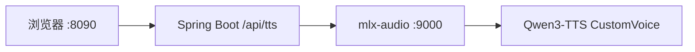

<div align="center">

# 千问和本地TTS模型文本转语音

本机把文字合成 WAV。浏览器里选音色、写语气，密钥和模型都不离开这台机器。

[](https://github.com/jiangshang-dev/qwen-tts-audio-demo)
[](https://github.com/jiangshang-dev/qwen-tts-audio-demo)
[](https://github.com/jiangshang-dev/qwen-tts-audio-demo)
[](https://huggingface.co/mlx-community/Qwen3-TTS-12Hz-1.7B-CustomVoice-8bit)

<br>

**先点上面的 Star，再克隆。** 用得上就标一颗星；用不上，请自觉不要 clone。谢谢。

[快速开始](#快速开始) · [音色](#音色) · [接口](#接口) · [常见问题](#常见问题) · [部署说明](docs/demo.md)

</div>

---

## 概览

页面把文字、音色和语气交给 Spring Boot，Spring Boot 再调用本机 mlx-audio。模型是 [Qwen3-TTS-12Hz-1.7B-CustomVoice-8bit](https://huggingface.co/mlx-community/Qwen3-TTS-12Hz-1.7B-CustomVoice-8bit)，只有预设的 9 个说话人。东北话、粤语、闽南语、台语、上海话不在这套音色里。

| | |
| --- | --- |
| **页面** | 文本、语气、音色，点一次就能听 |
| **接口** | `POST /api/tts` 返回 WAV，内部转到 OpenAI 兼容的 `/v1/audio/speech` |
| **语气** | 只改朗读方式，不改原文。预设专业、幽默、儿童，也可以自己写 |
| **边界** | 演示环境没有 ffmpeg，输出保持 WAV |



## 环境

| | 要求 |
| --- | --- |
| 本机链路 | Apple 芯片，统一内存至少 16 GB，磁盘再留 4 GB 以上 |
| 已跑通的机器 | Apple M5 Pro，48 GB 统一内存 |
| Python | 3.11，以及 mlx、mlx-audio |
| JDK / Maven | Java 21，Maven 3.9 及以上 |
| 模型 | 本机目录，并且包含 `speech_tokenizer` |

mlx-audio 依赖 Apple Metal。Intel Mac、Windows 和 Linux 不要安装它。这三类机器的配置、云端模型和费用见 [docs/demo.md](docs/demo.md)。

LM Studio 可以下载模型，但不能加载。它的 MLX 加载器不支持 `qwen3_tts`。合成请走 mlx-audio。

## 快速开始

**1. 准备模型目录**

`qwen.tts.model` 填本机绝对路径，不要填 Hugging Face 仓库名。填仓库名时，mlx-audio 会再下载大约 3 GB，并且不会使用已经下好的文件。

目录里除了主权重，还必须有 `speech_tokenizer/model.safetensors`（约 651 MB）。缺少这份语音解码器时，接口会先返回 HTTP 200，随后连接被掐断。

**2. 启动语音服务**

```bash
python3 -m pip install -U mlx-audio
python3 -m mlx_audio.server --host 0.0.0.0 --port 9000
```

**3. 启动页面**

先把 `src/main/resources/application.yml` 里的模型路径改成你的目录，再开一个终端：

```bash
mvn spring-boot:run
```

打开 <http://127.0.0.1:8090>。

第一次合成要把模型装进内存，一句话可能要十几秒。模型已经在内存里之后，短句通常一两秒就能返回。

## 配置

```yaml
server:
  port: 8090

qwen:
  tts:
    url: http://127.0.0.1:9000
    model: /你的本机目录/Qwen3-TTS-12Hz-1.7B-CustomVoice-8bit
    voice: Vivian
```

改完 yml 或 Java 后，重新执行 `mvn spring-boot:run`。只改 `index.html` 时，把文件同步到 `target/classes/static/index.html`，然后刷新浏览器。

## 使用

1. 在「文本」里写要朗读的内容。提示词不会改这段文字。
2. 选择语气，或自己写一句。留空则按音色的默认语气读。
3. 选择说话人。
4. 点「转语音」。按钮显示「转换中...」时不要重复点。成功后下方出现播放器。

| 预设 | 发给模型的句子 |
| --- | --- |
| 不指定 | 空 |
| 专业型 | 用专业、沉稳、清晰的语气朗读 |
| 幽默型 | 用幽默、轻松、带点俏皮的语气说 |
| 儿童型 | 用适合儿童的活泼、亲切、语速稍慢的语气说 |

0.6B 的 CustomVoice 会忽略 `instruct`。要语气，用这份 1.7B。

## 音色

名字不区分大小写。页面默认 Vivian。

| 取值 | 说明 | 取值 | 说明 |
| --- | --- | --- | --- |
| `vivian` | 女声 | `dylan` | 北京话男声 |
| `serena` | 女声 | `eric` | 四川话男声 |
| `uncle_fu` | 男声 | `ono_anna` | 日语女声 |
| `ryan` | 男声 | `sohee` | 韩语女声 |
| `aiden` | 男声 | | |

东北话、粤语、闽南语、台语、上海话要换云端模型，选型见 [docs/demo.md](docs/demo.md)。

## 接口

`POST /api/tts`，响应 `audio/wav`。

```bash
curl -sS -o speech.wav \
  -H 'Content-Type: application/json' \
  -d '{"text":"你好，我是龙宝。","voice":"vivian","instruct":"用专业、沉稳、清晰的语气朗读"}' \
  http://127.0.0.1:8090/api/tts
```

| 字段 | 说明 |
| --- | --- |
| `text` | 要朗读的文字 |
| `voice` | 说话人。不传时使用配置里的 `qwen.tts.voice` |
| `instruct` | 语气。空字符串表示不指定 |

Java 侧固定使用 HTTP/1.1，并把请求体一次写完。mlx-audio 只提供 HTTP/1.1。客户端如果走 HTTP/2，请求体可能被丢掉，接口会返回 422。

## 目录

```text
src/main/java/com/heima/audio/TextToSpeech.java    调用本机 /v1/audio/speech
src/main/java/com/heima/audio/TtsController.java   POST /api/tts
src/main/resources/static/index.html               演示页面
src/main/resources/application.yml                 端口、模型目录、默认音色
docs/demo.md                                       硬件、云端模型、Linux / Windows、费用
```

## 常见问题

| 现象 | 处理 |
| --- | --- |
| 一直停在「转换中」，日志里在下载 | 把 `model` 改成本机目录，不要写仓库名 |
| HTTP 200，音频下不完 | 补上 `speech_tokenizer`，然后重启 mlx-audio |
| 422，提示 body 缺失 | 客户端改用 HTTP/1.1。这个演示已经这样做 |
| 输出 MP3 时在 200 之后失败 | 本机没有 ffmpeg。继续使用 WAV |
| Windows 或 Linux 上照 Mac 命令启动 | mlx-audio 起不来。看 [docs/demo.md](docs/demo.md) |

## 进一步

硬件下限、云端模型和 Linux / Windows 的启动方式，以及租用、购买的大致费用，写在 [docs/demo.md](docs/demo.md)。

<div align="center">

<br>

[](https://github.com/jiangshang-dev/qwen-tts-audio-demo)

看完如果准备用，先点一颗 Star。

</div>
